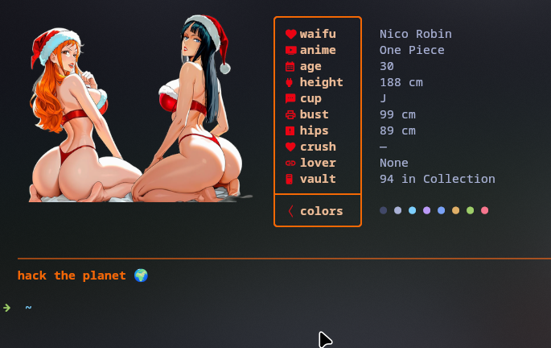

# 🌸 Fastfetch Waifu Vault

A dynamic, high-performance **Fastfetch** theme and configuration bundle featuring **1,920+ transparent anime waifu cutouts** across **88 characters** and **13 major anime series**, paired with adaptive terminal palette generation and detailed character stat cards.

---

## ✨ Features

- 🔞 **Waifu Info Cards**: In NSFW mode, Fastfetch automatically swaps system specs for comprehensive character details (Age, Height, Cup size, Bust, Hips, Crush, Partner/Lover, and Collection Count).
- 🎨 **Adaptive Color Harmony**: Fastfetch dynamically extracts the dominant accent color from whichever waifu is currently drawn, automatically styling terminal borders, icons, and shell environments.
- 🔄 **One-Command Toggle (`nsfw`)**: Type `nsfw` in any terminal to globally toggle between standard system info mode and waifu card mode across all open and future sessions.
- ⚡ **Zero-Latency Launch**: Pre-computed color palettes and column/row aspect ratio caching (`themes.json`) ensure instantaneous terminal load times (<10ms).
- 📺 **Kitty Graphics Protocol**: Crystal-clear high-res RGBA cutouts rendered natively using Kitty direct protocol (supported on Kitty, WezTerm, Ghostty, and modern terminal emulators).

---

## 📸 Preview



### Waifu Stat Card (NSFW Mode)
```text
╭───────────╮  
│  waifu   │  Nico Robin
│ 󰑈 anime   │  One Piece
│ 󰸗 age     │  30
│ 󰚥 height  │  188 cm
│ 󰍦 cup     │  J (official, Vivre Card)
│ 󱞆 bust    │  99 cm
│ 󰀧 hips    │  89 cm
│ 󰋑 crush   │  —
│ 󰌷 lover   │  None (canon)
│ 󰇅 vault   │  94 in Collection
├───────────┤  
│  colors  │  ● ● ● ● ● ● ● ●
╰───────────╯  
```

### Standard System Info (Normal Mode)
```text
╭───────────╮  
│  user    │  Kayden
│ 󰇅 hname   │  fedora
│ 󰅐 uptime  │  45 mins
│  distro  │  Fedora Linux 44
│  kernel  │  Linux 7.2.11
│  wm      │  Hyprland
│  term    │  kitty
│  shell   │  zsh
│ 󰍛 cpu     │  AMD Ryzen 5 5600H
│ 󰉉 disk    │  52 GiB / 138 GiB
│  memory  │  4.08 GiB / 7.09 GiB
├───────────┤  
│  colors  │  ● ● ● ● ● ● ● ●
╰───────────╯  
```

---

## 🚀 One-Click Installation

Clone the repository and run the automated installer:

```bash
git clone https://github.com/repo-girl/fastfetch-waifu-vault.git
cd fastfetch-waifu-vault
chmod +x install.sh
./install.sh
```

### Requirements:
1. **[Fastfetch](https://github.com/fastfetch-cli/fastfetch)** (`>= 2.0`)
2. **Python 3** + **Pillow** (`python3 -m pip install pillow`)
3. A terminal emulator with Kitty Graphics Protocol support (Kitty, Ghostty, WezTerm, etc.)
4. A [Nerd Font](https://www.nerdfonts.com/) installed (for icons like ``, `󰑈`, `󰸗`, etc.)

---

## 🎮 Usage & Activation

> [!IMPORTANT]
> **Activation Required:** Waifu cutouts and stat cards are activated only after toggling **`nsfw`** mode on!

1. **Activate Waifu Mode**:
   Run the toggle command once in your terminal:
   ```bash
   nsfw
   ```
   *(This enables Waifu Card Mode across all terminal windows).*

2. **Display Fastfetch**:
   ```bash
   fastfetch
   ```
   *(Pulls a random waifu, calculates real-time color accents, and prints her stat card).*

3. **Toggle Back / Deactivate**:
   Type `nsfw` again anytime to switch back to clean **Standard System Info Mode** (ideal for screen sharing, school, or work).

---

## 📁 Included Anime Series (88 Characters)

- **One Piece**: Nico Robin, Nami, Boa Hancock, Yamato, Reiju, Perona, Ulti, Kalifa, Viola, Monet, Tashigi, Hina...
- **Bleach**: Rangiku Matsumoto, Yoruichi Shihoin, Nelliel, Tier Harribel, Retsu Unohana, Sui-Feng, Candice Catnipp, Masaki Kurosaki...
- **Naruto & Boruto**: Tsunade Senju, Mei Terumi, Hinata Hyuuga, Sakura Haruno, Ino Yamanaka, Hanabi, Temari, Samui, Anko, Kurotsuchi, Kurenai...
- **Demon Slayer**: Mitsuri Kanroji, Shinobu Kocho, Daki, Tamayo, Hinatsuru...
- **My Hero Academia**: Mirko (Rumi Usagiyama), Nejire Hado, Mt. Lady, Midnight, Star and Stripe, Burnin, Bubble Girl...
- **Jujutsu Kaisen**: Mei Mei, Yuki Tsukumo, Shoko Ieiri, Utahime Iori...
- **KonoSuba**: Darkness (Lalatina), Aqua, Wiz...
- **Spy × Family**: Yor Forger, Fiona Frost, Sylvia Sherwood...
- **Attack on Titan**: Pieck Finger, Hange Zoe, Petra Rall, Yelena...
- **Black Clover**: Vanessa Enoteca, Charlotte Roselei, Mereoleona Vermillion...
- **Fire Force**: Princess Hibana, Maki Oze...
- **Grand Blue Dreaming**: Chisa Kotegawa, Nanaka Kotegawa, Azusa Hamaoka, Aina Yoshiwara...

---

## 🗑️ Uninstallation

To restore your previous fastfetch setup and remove all vault assets:

```bash
./uninstall.sh
```

---

## 📄 License

MIT License. See [LICENSE](LICENSE) for details.
